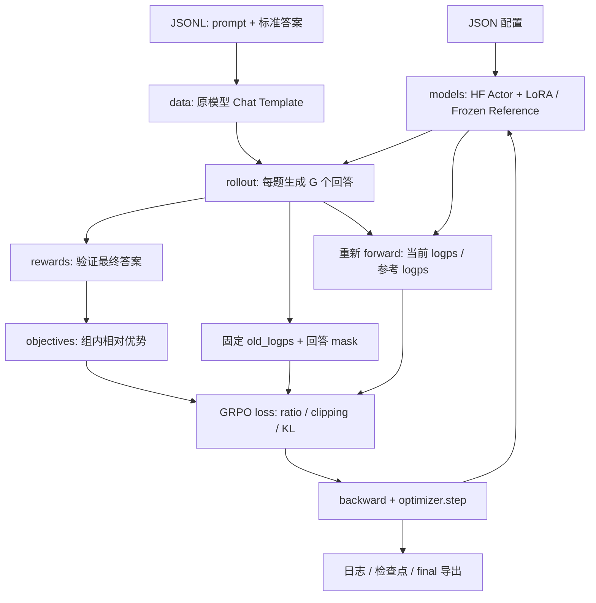

# 架构与实验指南

## 模块关系



三个数据面独立：Tokenizer 决定输入格式；Verifier 决定正确性；Objective 决定如何把奖励转换成梯度。换 Qwen/Llama 通常只动模型配置和 LoRA 目标层，不改 GRPO 公式。换任务主要动数据和 verifier。

## 对照 MiniMind 阅读

| MiniMind 位置 | 本项目位置 | 改造原因 |
|---|---|---|
| `trainer_utils.init_model` | `models.load_bundle` | 固定 MiniMind 类与 .pth 改为通用 HF 目录/仓库 |
| `RLAIFDataset` | `data.load_jsonl/render_prompt` | 不写死 im_start/im_end，也不依赖最后一条 assistant |
| `calculate_rewards` | `rewards.math_reward` / 插件 | 通用 RM 分数改成数学可验证奖励，标准答案留在模型外 |
| `create_rollout_engine` | `PytorchRolloutEngine` | 同步采样、微批、EOS和实际 attention mask |
| `grpo_train_epoch` 中公式 | `objectives.py` | 与模型分离，单独验证梯度和归一化 |
| `.pth` checkpoint | HF `save_pretrained` + 训练状态 | 区分 adapter、完整权重、恢复优化器/游标/RNG |

MiniMind 本地脚本的默认 `loss_type` 是 CISPO。本项目明确以标准 clipped GRPO 为起点，没有把 CISPO 当作 vanilla GRPO。

## 一步训练到底保存了哪些材料

设 `B` 道题，每题 `G` 个回答，总数 `N=B×G`；左补齐后的 prompt 宽度 `P`，回答补齐宽度 `R`。

| 材料 | 形状 | 用途 |
|---|---|---|
| `input_ids` / `attention_mask` | `[N,P+R]` | 当前/参考模型 forward |
| `completion_ids` / `completion_mask` | `[N,R]` | 回答与有效动作位置 |
| `old_logps` | `[N,R]` | 采样时 Actor 的概率快照，detach |
| `reference_logps` | `[N,R]` | 初始冻结基座的概率，beta=0时省略 |
| `rewards` | `[N]` | 每条回答的正确性分数 |
| `advantages` | `[N]` | 同题比较，广播到该回答有效 token |
| `current_logps` | `[N,R]` | 每次优化重新计算，包含梯度 |

样本顺序必须是 `[题0回答0,题0回答1,...,题1回答0,...]`，这样 `rewards.view(B,G)` 才不会把不同问题混成一组。

`attention_mask` 允许 prompt 与回答参与上下文计算；`completion_mask` 只把回答中的有效动作计入 loss。首次 EOS 也是模型作出的结束动作，因此包含在 mask 内。`pad_id==eos_id` 时不能简单使用 `ids != pad_id`。left padding 的位置编号来自 attention mask 的累加，补齐不会挤占真实 token 的位置。

## 核心公式

每题 G 个奖励的平均数和总体标准差为 `μ`、`σ`：

\[
A_i=\frac{r_i-\mu}{\sigma+10^{-4}},\qquad
\rho_{i,t}=\exp(\log\pi_\theta-\log\pi_{old}).
\]

当前基线的逐 token 损失：

\[
\ell_{i,t}=-\min\left(\rho_{i,t}A_i,
\operatorname{clip}(\rho_{i,t},1-\epsilon_{low},1+\epsilon_{high})A_i\right)
+\beta\left(e^{d_{i,t}}-d_{i,t}-1\right),
\quad d_{i,t}=\log\pi_{ref}-\log\pi_\theta.
\]

其中 `old` 是这批回答采样时的模型，`ref` 是实验开始时的固定基座。它们可以最初相同，训练后职责不同。KL 项是采到 token 上的 k3 估计，不是对整个词表精确求和的 KL。

- `sequence`：每条回答先对有效 token 平均，再对回答平均，与 MiniMind 主线一致。
- `token`：整个优化窗口的有效 token 一起平均，长回答包含更多 token。跨 micro batch/累积窗口仍使用同一个全局分母。

同题全对或全错时，组内奖励方差为 0，`A=0`。有 KL 时仍可能因 KL 产生更新，不能把“无 policy gradient”误称为“所有参数绝对不动”。当前只记录这类组的比例，**没有用额外长度分制造优势，也没有自动跳过它们**。

## 配置含义与可比较性

| 配置 | 含义 |
|---|---|
| `prompt_batch_size` | 一次处理几道题，B |
| `num_generations` | 每题几个回答，G，必须>=2 |
| `rollout_micro_batch_size` | 生成/保存旧概率时一次处理几条回答，控制显存 |
| `train_micro_batch_size` | 反传时一次处理几条回答，控制显存 |
| `gradient_accumulation_steps` | 先收集多少批题目，再积累成一次优化 |
| `updates_per_rollout` | 固定同批回答/old概率，更新 Actor 几次 |
| `max_steps` | 优化器更新上限，不是题目数或 rollout 次数 |
| `beta` | Reference KL系数；0时不加载 Reference |

只更新一次时，首次 forward 的 ratio≈1，clip 通常没有机会生效。要研究 Clip-Higher，可以复用回答更新多次，或引入其他有明确滞后策略的方案；本项目选择前者。首个更新后 Actor 改变，old 仍固定，第二次 forward 才可能触发裁剪。记录 `ratio_mean` / `clip_fraction` 检查实际是否发生；未触发时不能宣称 Clip-Higher 改善训练。

默认 `temperature=1,top_p=1,top_k=0`，让采样与原始策略一致。代码中的新/旧/ref log-prob 都取未经过采样截断的模型分布。改用非1温度或top-p后，采样行为分布不同；本项目不会自动进行重要性校正，请把这种改动作为单独实验设置。

优化器使用 AdamW、固定学习率和可选梯度范数裁剪；当前没有 warmup 或学习率调度器。它与原 MiniMind 脚本的 cosine 调度不同。后续比较论文设置时，应明确记录并对齐这些训练超参数。

## 消融路线

1. **先做可靠的 GRPO 基线**：固定基座 revision、LoRA 设置、数据split、验证器、采样预算、seed。真实采样检查能否产生正负奖励，而不是只观察 loss 数字。
2. **Clip-Higher**：使用 `qwen05b_clip_higher.json`，只改变 `clip_high`。其余实验条件要相同，包括复用更新次数。
3. **Token-level Loss**：使用 `qwen05b_token_loss.json`，只改变 `loss_reduction`。当前模板是单因素实验；若要做累积消融，应显式保留上一阶段改动并另命名输出目录。
4. **实现 Dynamic Sampling**：在 `trainer` 准备材料之后、优化之前按同题奖励方差筛选整组，并继续采题填满有效组预算。要记录总采题数/生成token/耗时，不能只比较优化器步数。注意恢复时额外采样的数据游标也要保存。
5. **实现 Overlong Reward Shaping**：利用 `rollout.truncated` 和回答长度设计长度缓冲区、截断惩罚/样本屏蔽；具体规则与论文对齐，单独验证边界，不能把“无EOS”全部当成语义错误。
6. **完整 DAPO**：四个技术齐备后，核对 KL、优势归一、token分母、采样和超长mask等细节，再报告与论文/图片实现的差异。

两项开关不等于完整 DAPO；这个项目保留 KL 的基线也不能直接冒充论文原始 DAPO 设置。不能预先保证复现出图片中的熵坍缩或提升幅度，应报告自己的多种子结果和不确定性。

评估至少同时保留：独立测试集 pass@1/pass@8、逐题回答、entropy、有效 token 数、回答长度/截断率、原始组内方差/零方差组比例、clip fraction、KL 和墙钟时间。相同数据/基座之外，还应对齐**总生成 token 预算**和优化预算，才能解释“采样效率提升”。

## 奖励扩展

新建可导入 Python 模块，函数签名：

```python
def reward(completion: str, answer: str) -> float:
    # 只负责判分；不要让标准答案进入 Actor prompt。
    return 1.0 if verified_correct(completion, answer) else 0.0
```

配置 `reward_function: "你的模块:reward"`。正式 verifier 应是无状态、可重复的纯函数；有状态插件不在 checkpoint 中恢复。评估必须使用二元正确性 verifier，不能把有长度分/格式分的总 reward 当 pass@k。
